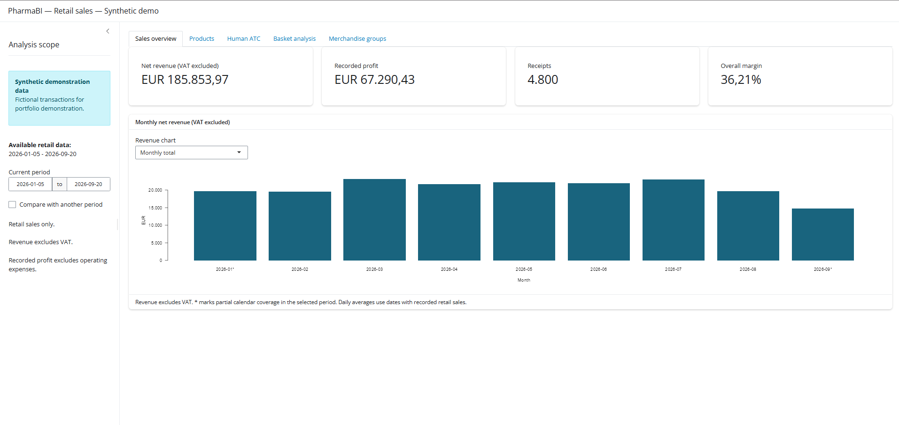
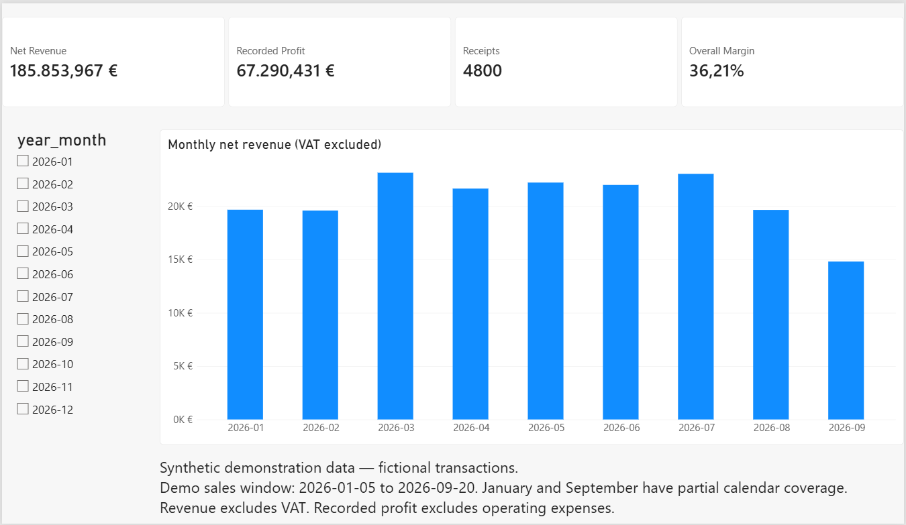
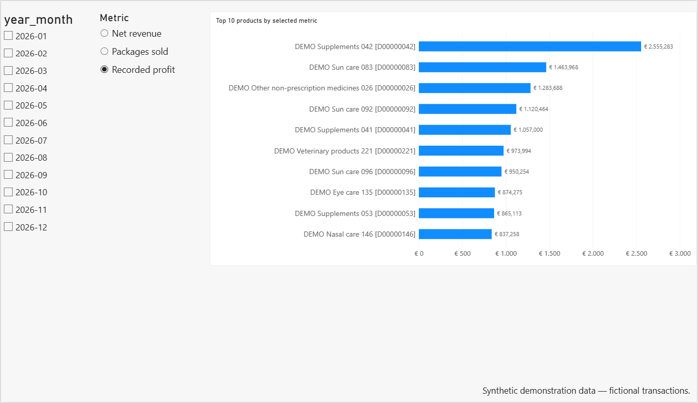
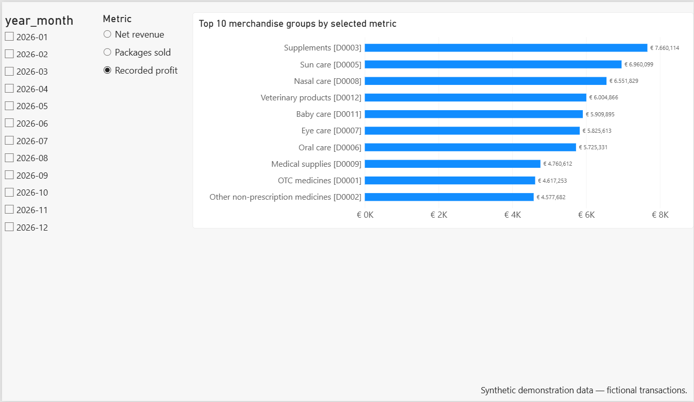
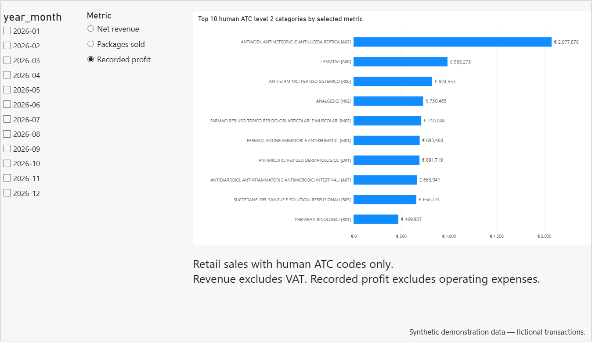

# 💊 PharmaBI

**Un progetto portfolio di analisi delle vendite ispirato all'attività di una parafarmacia italiana.**

[Read in English](README.md)

**[Apri la demo interattiva in Shiny (dati sintetici)](<https://01a1c1a8-7b8a-ef13-5420-bf7796c076e7.share.connect.posit.cloud/>)**

Filtra per periodo ed esplora vendite, margini e prodotti acquistati insieme. Non serve installare nulla.

PharmaBI è un progetto personale di **Danilo Caporicci** che integra R, SQL, SQLite, Shiny e Power BI per trasformare il dettaglio degli scontrini in indicatori analitici documentati.

**La dimostrazione pubblica utilizza transazioni sintetiche, prodotti e produttori fittizi. Tutti i risultati numerici e gli screenshot qui presentati riguardano la demo.** Le classificazioni utilizzano metadati ATC pubblici. La demo non descrive risultati o clienti di un'attività reale.

## Competenze e funzionalità

- Preparazione dei dati, definizione della granularità e regole di validazione.
- Riconciliazione tra calcoli R e aggregazioni SQLite.
- Analisi di vendite retail, prodotti, gruppi merceologici (GM) e categorie ATC umane.
- Struttura degli scontrini e associazioni tramite supporto, confidence e lift.
- Filtri e confronto tra periodi in Shiny.
- Quattro pagine Power BI con gli stessi dati retail e le stesse definizioni dei KPI.

Acquisti, movimenti di magazzino, forecasting e confronti storici restano sviluppi futuri.

## Baseline della demo

Il periodo sintetico verificato è **2026-01-05 – 2026-09-20**.

| Indicatore retail | Valore demo verificato |
|---|---:|
| Righe / presenze prodotto negli scontrini | 7.817 |
| Scontrini | 4.800 |
| Prodotti distinti venduti | 240 |
| Confezioni nette | 9.607 |
| Ricavi netti | EUR 185.853,967 |
| Costi dei prodotti registrati | EUR 118.563,536 |
| Profitto registrato | EUR 67.290,431 |
| Margine complessivo | 36,21% |

La fact table completa contiene **7.835 righe**, comprese tre transazioni non retail escluse dai KPI retail.

Questi valori descrivono il dataset e il riferimento pubblico utilizzati nella verifica. La riproduzione esatta dipende anche dallo snapshot ATC, dalla configurazione R/RNG e dalle versioni dei pacchetti; il solo seme fisso non basta quando tali input cambiano.

## Interfacce disponibili

### Shiny

Cinque schede:

- **Sales overview:** KPI, totali mensili, medie giornaliere e confronti tra periodi.
- **Products:** classifiche per profitto registrato, ricavi netti o confezioni.
- **Human ATC:** categorie di livello 2 secondo la regola di separazione umana/veterinaria implementata.
- **Merchandise groups:** grafico del profitto e confronto dei ricavi per categoria, totali o per giorno attivo.
- **Basket analysis:** composizione degli scontrini, confronto dei carrelli e coppie di prodotti con soglia minima di co-occorrenza.

L'app utilizza connessioni SQLite in sola lettura. Le date seguono `YYYY-MM-DD`; i numeri hanno virgola decimale e punto per le migliaia.

Shiny si avvia normalmente in modalità demo e mostra **Synthetic demonstration data**. Una modalità privata esplicita è mantenuta per l'utilizzo operativo locale autorizzato.



*Transazioni fittizie. Gli asterischi indicano i mesi con copertura parziale del calendario.*

### Power BI

Sono implementate **Sales overview**, **Products**, **Merchandise groups** e **Human ATC**.

Il mese è sincronizzato tra tutte le pagine. Le tre classifiche condividono il selettore di profitto registrato, ricavi netti o confezioni. La metrica controlla valori, filtro Top 10 e ordinamento.



*Transazioni fittizie. Gennaio e settembre hanno copertura parziale del calendario.*

<details>
<summary>Visualizza le tre pagine delle classifiche</summary>







</details>

Il PBIP versionato è la copia portfolio. La copia operativa è conservata separatamente fuori dal repository. Le modifiche ai due progetti Power BI non si sincronizzano automaticamente.

Confronto tra periodi e basket analysis in Power BI sono estensioni future; queste funzioni sono già disponibili in Shiny.

### Analisi R e report esistenti

`R/analysis/` contiene le analisi descrittive originali. Il flusso R Markdown esistente supporta HTML/PDF e invio email configurato localmente.

**Questi punti di ingresso delle analisi e dei report utilizzano ancora i percorsi privati.** Sono separati dai comandi demo riportati sotto. L'integrazione del report con la demo è ancora da completare. Il flusso operativo di generazione e invio era stato verificato su Windows 11; credenziali e report generati rimangono locali.

## Avviare la demo pubblica

Aprire `PharmaBI.Rproj` in RStudio. Questo percorso non richiede esportazioni operative riservate o credenziali email.

### 1. Installare le dipendenze demo

Nella Console R:

```r
install.packages(c(
  "dplyr", "readr", "here", "DBI",
  "RSQLite", "shiny", "bslib"
))
```

### 2. Preparare il riferimento ATC pubblico

Se manca `data/reference/atc_reference.rds`:

```r
source(here::here("R", "reference", "01_build_atc_reference.R"))
```

Lo script scarica e valida dati pubblici AIFA. Il download richiede Internet. Conservare lo stesso snapshot per riprodurre una demo già generata.

### 3. Generare, validare e costruire il database

Eseguire gli script interi nell'ordine:

```r
source(here::here("R", "demo", "01_generate_demo_data.R"))
source(here::here("R", "demo", "02_build_demo_database.R"))
source(here::here("R", "demo", "03_export_demo_powerbi.R"))
source(here::here("R", "demo", "04_verify_demo.R"))
```

Il generatore costruisce direttamente una fact table sintetica: non simula i quattro CSV grezzi del gestionale. La demo verifica quindi il validatore condiviso e i componenti successivi, mentre importazione e pulizia restano nel percorso privato.

I file RDS, SQLite e CSV generati sono sotto `data/demo/`, esclusa da Git. Il [verificatore demo](docs/demo_verification.md) controlla la baseline documentata, le query per periodo, gli scontrini, le coppie di prodotti e gli export CSV. Salva risultati, impronte degli input e versioni della sessione di verifica in una sottocartella dedicata a ogni esecuzione sotto `data/demo/validation/`.

### 4. Avviare Shiny

```r
Sys.setenv(PHARMABI_DATA_MODE = "demo")

shiny::runApp(
  here::here("dashboard"),
  launch.browser = TRUE
)
```

Per terminare l'app usare **Stop** in RStudio. Riavviarla dopo aver ricostruito il database.

### 5. Aprire Power BI su Windows

1. Aprire `powerbi/PharmaBI.pbip` in Power BI Desktop.
2. In **Home → Trasforma dati → Modifica parametri**, impostare `DataFolder` sul percorso assoluto locale di `data/demo/powerbi/`, includendo la barra finale, ad esempio `C:\Projects\PharmaBI\data\demo\powerbi\`.
3. Applicare la modifica e aggiornare.
4. Togliere le selezioni dei mesi e confrontare i KPI con la baseline demo.

La cartella contiene `fact_sales_retail.csv`, `dim_date.csv`, `dim_products.csv` e `dim_atc_level2.csv`. Power Query ricava `dim_gm` dalle vendite retail: non serve un CSV GM separato.

## Architettura e sorgenti

| Percorso | Ruolo |
|---|---|
| `R/config/data_paths.R` | Risoluzione esplicita dei percorsi `demo`/`private` |
| `R/demo/` | Generazione sintetica, validazione/database ed esportazione demo |
| `R/validation/validate_fact_sales.R` | Validatore condiviso con input RDS esplicito |
| `R/database/build_database.R` | Costruttore SQLite e riconciliazione SQL/R condivisi |
| `R/export/export_powerbi.R` | Esportazione condivisa con database in sola lettura |
| `R/pipeline/` | ETL privato del gestionale e relativo ingresso di validazione |
| `R/reference/` | Costruzione del riferimento ATC pubblico |
| `R/analysis/` | Analisi R esistenti con percorsi privati |
| `R/reporting/` | Generazione e invio del report operativo |
| `sql/` | Vista e query analitiche |
| `dashboard/app.R` | Applicazione Shiny |
| `powerbi/` | Definizioni del report portfolio e del modello semantico |
| `reports/` | Sorgente del report R Markdown operativo |
| `docs/` | Documentazione pubblica e immagini demo |

SQLite contiene `fact_sales`, `dim_products`, `dim_date`, `dim_atc_level2` e `vw_retail_sales`. Il [modello dati](docs/model.Rmd) distingue lookup ETL, tabelle SQLite e relazioni Power BI.

## Definizioni e limiti

- **Ricavi netti:** ricavi di riga al netto dell'IVA; nella demo sono generati direttamente su questa base.
- **Profitto registrato:** ricavi netti meno costi dei prodotti registrati, prima delle spese operative.
- **Margine complessivo:** profitto registrato totale diviso ricavi netti totali.
- **Giorni attivi:** date distinte con transazioni retail registrate.
- **Scontrini:** identificativi di transazioni, non identità dei clienti.
- **Confezioni nette:** quantità con segno, compresi i resi negativi.

La demo include intenzionalmente resi, vendite sotto costo e costi registrati a zero. Il profitto negativo di un reso richiede un'interpretazione diversa da una vendita sotto costo.

Mesi parziali e osservazioni mancanti vanno distinti dai periodi completi senza vendite. Le medie giornaliere non eliminano gli effetti della composizione settimanale. Le assegnazioni ATC ai prodotti fittizi illustrano il comportamento del software: non sono registrazioni di medicinali o prove di diagnosi. Le coppie introdotte nel generatore sono scenari dimostrativi, non raccomandazioni empiriche.

I soli dati di vendita non dimostrano rotazione delle scorte, domanda non soddisfatta, fabbisogno di riordino o effetti climatici.

## Verifiche e portabilità

Su Windows 11 la fact sintetica ha superato tutte le 14 verifiche; i risultati SQLite per tipo di vendita e mese sono stati riconciliati con R. Il confronto dell'impronta del database privato prima e dopo la costruzione demo ne ha confermato l'invarianza.

Shiny demo e le quattro pagine Power BI sono stati controllati localmente su Windows 11. Il 2026-11-03 anche generazione demo, costruzione SQLite, export CSV e Shiny sono stati verificati in una copia separata del portfolio su Linux Mint. Il nuovo verificatore automatico ha superato tutti i **70 controlli sia su Linux sia su Windows**, compresa la riconciliazione indipendente delle coppie tra R e SQL. **macOS e un'installazione da zero su un nuovo computer rimangono non verificati.**

Git trasferisce sorgenti e documenti, non dataset generati, pacchetti installati, cache o credenziali. Dopo un cambio di PC rigenerare i file demo locali. Power BI Desktop è l'implementazione per Windows.

## Documentazione

- [Risultati dimostrativi](docs/business_findings.md)
- [Modello dati](docs/model.Rmd)
- [Dizionario dei dati](docs/data_dictionary.md)
- [Rapporto sulla qualità](docs/data_quality_report.md)
- [Documentazione tecnica](docs/technical_documentation.md)
- [Note pubbliche di sviluppo](docs/project_notes.md)

La [guida email esistente](docs/report_email_setup.md) riguarda il percorso operativo separato.

## Stato e prossimi passi

La versione candidata per il portfolio comprende dati sintetici, funzioni condivise di validazione/database/esportazione, Shiny e quattro pagine Power BI. Prima del tag restano la revisione del repository e della cronologia e i controlli degli altri materiali pubblici.

Gli sviluppi futuri comprendono confronti storici, acquisti e magazzino, ulteriori funzioni Power BI e una guida didattica. Il download CSV rimane facoltativo. Le ricerche su clima e domanda sanitaria richiedono evidenze adeguate e non costituiscono conclusioni della demo.
