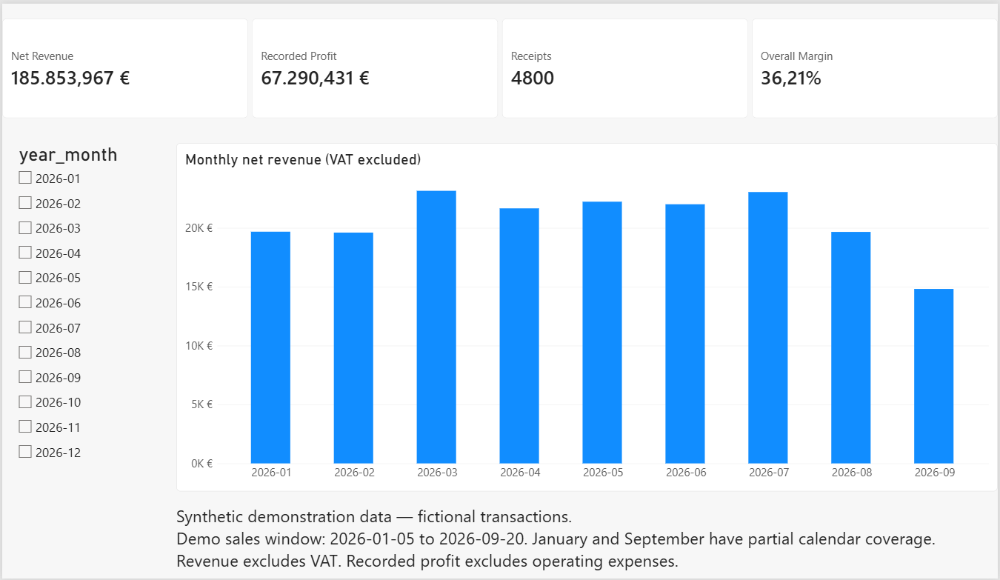
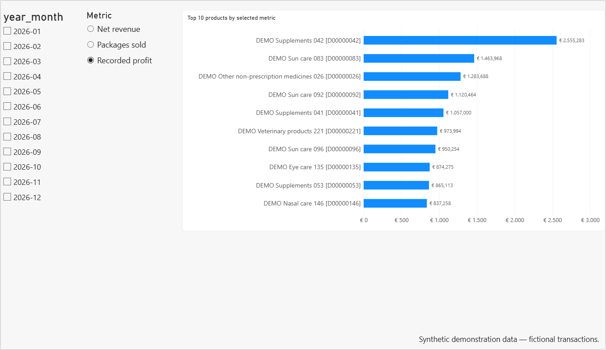
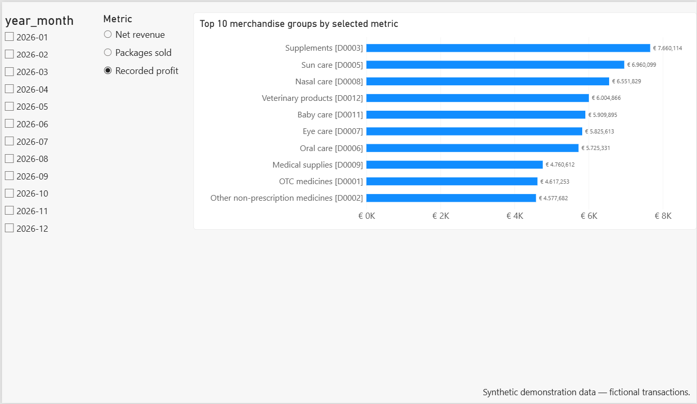
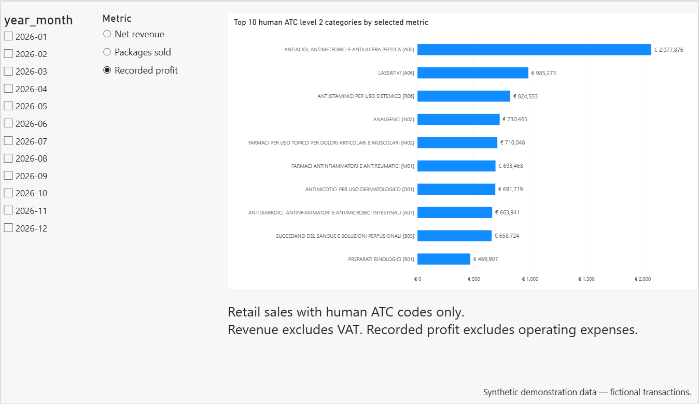

# 💊 PharmaBI

**A retail analytics portfolio project inspired by the operations of an Italian parafarmacia.**

[Leggi in italiano](README.it.md)

PharmaBI is a personal project by **Danilo Caporicci**, combining R, SQL, SQLite, Shiny and Power BI to turn receipt-level data into documented analytical indicators.

**The public demonstration uses synthetic transactions, fictional products and fictional manufacturers. All numerical results and screenshots presented here refer to that demonstration.** Public ATC reference metadata are retained for classification examples. The demo does not describe the performance or customers of a real business.

## What the project demonstrates

- Data preparation, explicit analytical grain and validation rules.
- Reconciliation of R calculations with SQLite aggregations.
- Retail sales, product performance, merchandise groups (GM) and human ATC category analysis.
- Receipt structure and product-pair analysis with support, confidence and lift.
- Interactive filtering and period comparisons in Shiny.
- A four-page Power BI report using the same retail data and KPI definitions.

Purchasing, stock movements, forecasting and comparisons across historical years remain future work.

## Demo baseline

The tested synthetic sales window is **2026-01-05 to 2026-09-20**.

| Retail indicator | Verified demo value |
|---|---:|
| Sales rows / receipt-product presences | 7.817 |
| Receipts | 4.800 |
| Distinct products sold | 240 |
| Net packages | 9.607 |
| Net revenue | EUR 185.853,967 |
| Recorded product costs | EUR 118.563,536 |
| Recorded profit | EUR 67.290,431 |
| Overall margin | 36,21% |

The complete demo fact table has **7.835 rows**. It includes three additional non-retail transactions, kept outside retail KPIs.

These values describe the tested fixture and reference snapshot. Exact reproduction also depends on the public ATC reference, R/RNG configuration and package versions; the fixed seed alone is insufficient if those inputs change.

## Available interfaces

### Shiny

Five tabs provide:

- **Sales overview:** KPIs, monthly totals, daily averages and comparisons between two periods.
- **Products:** rankings by recorded profit, net revenue or packages.
- **Human ATC:** ATC level 2 rankings using the implemented human/veterinary scope rule.
- **Merchandise groups:** a profit chart and category revenue comparisons, with total or per-active-day values.
- **Basket analysis:** receipt composition, basket comparisons and product-pair indicators with a minimum co-occurrence threshold.

The application uses read-only SQLite connections. Dates use `YYYY-MM-DD`; numeric displays use a decimal comma and a dot for thousands.

Shiny defaults to demo mode and displays **Synthetic demonstration data**. An explicit private mode is retained for authorized local operational use.

### Power BI

Four pages are implemented: **Sales overview**, **Products**, **Merchandise groups** and **Human ATC**.

Month selections are synchronized across all pages. The three ranking pages share a selector for recorded profit, net revenue or packages sold. The selected measure controls chart values, Top 10 filtering and sorting.



*Fictional transactions. January and September cover only part of a calendar month.*

<details>
<summary>View the three ranking pages</summary>







</details>

The tracked PBIP is the portfolio copy. A separate operational copy is kept outside the repository. Changes to the two Power BI projects do not synchronize automatically.

Power BI period comparisons and basket analysis are future extensions; those functions are already available in Shiny.

### Existing R analyses and reporting

`R/analysis/` contains the original descriptive analyses. The existing R Markdown workflow supports HTML/PDF generation and locally configured email delivery.

**Those legacy analysis/report entry points still use private data paths.** They are outside the public demo commands below. Demo report integration remains pending. The operational reporting/email workflow was previously verified on Windows 11; credentials and generated reports are local.

## Run the public demo

Open `PharmaBI.Rproj` in RStudio. Operational CSV exports and email credentials are not required for this path.

### 1. Install demo dependencies

Run in the R Console:

```r
install.packages(c(
  "dplyr", "readr", "here", "DBI",
  "RSQLite", "shiny", "bslib"
))
```

### 2. Prepare the public ATC reference

If `data/reference/atc_reference.rds` is absent:

```r
source(here::here("R", "reference", "01_build_atc_reference.R"))
```

This builder downloads public AIFA data and validates the reference. Internet access is needed for the download. Retain the same snapshot when reproducing a previously generated demo.

### 3. Generate, validate and build

Run the complete scripts in order:

```r
source(here::here("R", "demo", "01_generate_demo_data.R"))
source(here::here("R", "demo", "02_build_demo_database.R"))
source(here::here("R", "demo", "03_export_demo_powerbi.R"))
```

The generator creates a synthetic fact table directly; it does not simulate the four raw management-system CSV exports. The demo therefore exercises the shared fact validator and downstream consumers, rather than the private import/cleaning pipeline.

Generated RDS, SQLite and CSV files are under `data/demo/` and excluded from Git.

### 4. Launch Shiny

```r
Sys.setenv(PHARMABI_DATA_MODE = "demo")

shiny::runApp(
  here::here("dashboard"),
  launch.browser = TRUE
)
```

Use **Stop** in RStudio to end the application. Restart it after rebuilding its database.

### 5. Open Power BI on Windows

1. Open `powerbi/PharmaBI.pbip` in Power BI Desktop.
2. In **Home → Transform data → Edit parameters**, set `DataFolder` to the absolute local `data/demo/powerbi/` path, including the final backslash, for example `C:\Projects\PharmaBI\data\demo\powerbi\`.
3. Apply the change and refresh.
4. Clear month selections and compare the overview with the demo baseline above.

The directory contains `fact_sales_retail.csv`, `dim_date.csv`, `dim_products.csv` and `dim_atc_level2.csv`. Power Query derives `dim_gm` from retail sales, so there is no separate GM CSV.

## Architecture and source layout

| Path | Role |
|---|---|
| `R/config/data_paths.R` | Explicit `demo`/`private` path resolver |
| `R/demo/` | Synthetic generation, validation/build and Power BI export commands |
| `R/validation/validate_fact_sales.R` | Shared validator with an explicit RDS input |
| `R/database/build_database.R` | Shared SQLite builder and SQL/R reconciliation |
| `R/export/export_powerbi.R` | Shared read-only database exporter |
| `R/pipeline/` | Private management-system ETL and its validation entry point |
| `R/reference/` | Public ATC reference builder |
| `R/analysis/` | Existing R analyses using private paths |
| `R/reporting/` | Existing operational reporting and email handler |
| `sql/` | View definition and analytical queries |
| `dashboard/app.R` | Shiny application |
| `powerbi/` | Portfolio report and semantic model definitions |
| `reports/` | Existing operational R Markdown report source |
| `docs/` | Public documentation and demo images |

The SQLite model contains `fact_sales`, `dim_products`, `dim_date`, `dim_atc_level2` and `vw_retail_sales`. See the [data model](docs/model.Rmd) for the distinction between ETL lookup tables, SQLite tables and Power BI relationships.

## Definitions and limits

- **Net revenue:** line revenue excluding VAT in the analytical model; demo values are generated directly on that basis.
- **Recorded profit:** net revenue minus recorded product costs, before operating expenses.
- **Overall margin:** total recorded profit divided by total net revenue.
- **Active days:** distinct dates with recorded retail transactions.
- **Receipts:** transaction identifiers, not customer identities.
- **Net packages:** signed quantities, including negative return quantities.

The demo intentionally includes returns, below-cost sales and zero recorded costs. A negative profit on a return has a different interpretation from a below-cost sale.

Partial months and missing observations must be distinguished from complete zero-sales periods. Daily averages do not remove weekday-composition effects. ATC assignments to fictional products illustrate software behaviour; they are not actual product registrations or evidence of diagnoses. Injected product pairs are demonstration scenarios, not empirical recommendations.

Sales data alone do not establish stock turnover, unmet demand, replenishment needs or climate effects.

## Validation and portability

On Windows 11, the synthetic fact table passed all 14 validator checks; SQLite sales-by-type and monthly results reconciled with R. A before/after fingerprint check confirmed that building the demo database left the private database unchanged.

Demo Shiny and the four Power BI pages were checked locally on Windows 11. Earlier Shiny and private-pipeline work was also exercised on Linux Mint. **The complete new demo sequence still needs verification on Linux; macOS remains unverified.** A clean installation test on a new machine is also pending.

Git transfers source and documentation, not generated datasets, installed packages, caches or credentials. Regenerate local demo files after switching computers. Power BI Desktop is the Windows implementation.

## Documentation

- [Demonstration findings](docs/business_findings.md)
- [Data model](docs/model.Rmd)
- [Data dictionary](docs/data_dictionary.md)
- [Data quality report](docs/data_quality_report.md)
- [Technical documentation](docs/technical_documentation.md)
- [Public development notes](docs/project_notes.md)

The existing [email setup guide](docs/report_email_setup.md) concerns the separate operational reporting workflow.

## Status and next steps

The portfolio release candidate includes synthetic data, shared validation/build/export functions, Shiny and four Power BI pages. Final repository/history review and remaining public-asset checks precede the release tag.

Future work includes historical comparisons, purchasing and stock integration, further Power BI features and an educational guide. CSV download remains optional. Climate and healthcare-demand research require suitable evidence and are not conclusions supported by the demo.
