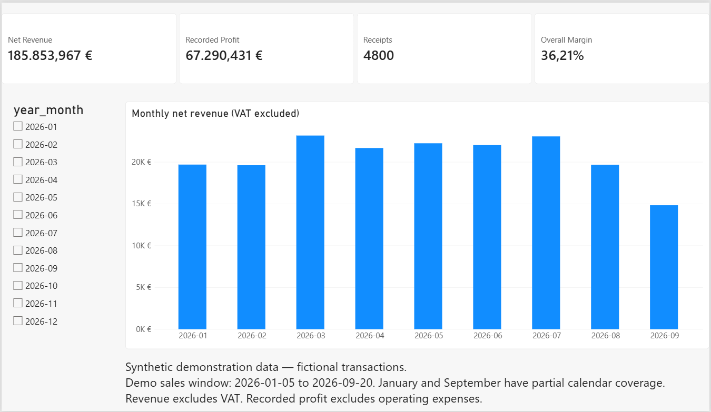
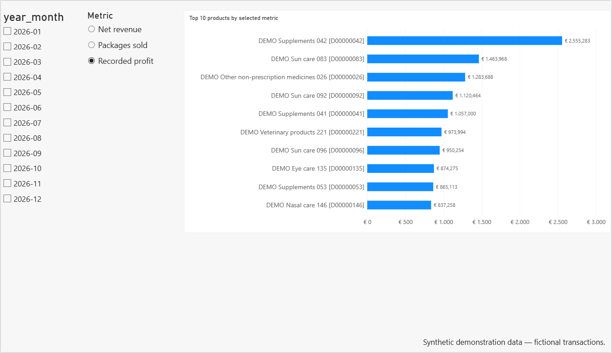
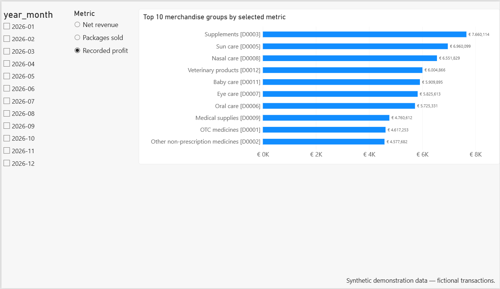
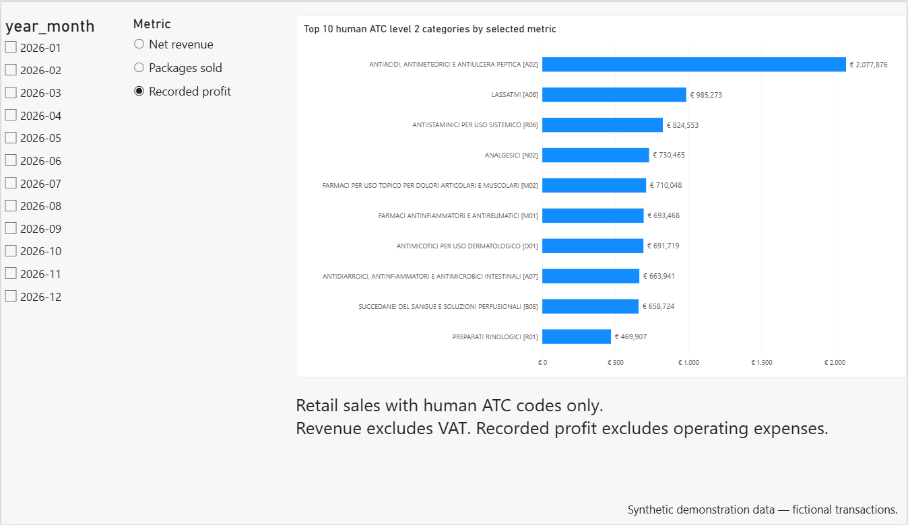

# PharmaBI — Demonstration findings

**Synthetic demonstration data.** Every numerical example below concerns fictional transactions generated for the portfolio. These are worked analytical examples, not findings about a real parafarmacia.

The demo window is **2026-01-05 to 2026-09-20**. Monetary tables use a decimal comma and a dot for thousands. Values retain three decimal places for reconciliation.

## 1. Establish the retail baseline

**Question:** What activity does the selected sales dataset represent?

| Retail indicator | Verified demo result |
|---|---:|
| Receipt-product rows | 7.817 |
| Receipts | 4.800 |
| Distinct products | 240 |
| Net packages | 9.607 |
| Net revenue | EUR 185.853,967 |
| Recorded costs | EUR 118.563,536 |
| Recorded profit | EUR 67.290,431 |
| Overall margin | 36,21% |

The full fact table includes another 18 rows belonging to three non-retail transactions. Those are excluded from retail receipt and economic indicators.

**Analytical use:** the baseline makes transaction scope explicit before evaluating products, categories or changes.

**Limit:** recorded profit subtracts recorded product costs, not operating expenses. The fixture deliberately includes zero recorded costs, below-cost sales and returns.

**Evidence:** the shared fact validator passed 14 checks; sales-by-type and monthly SQLite aggregations reconciled with R. Overview KPIs also matched Shiny and Power BI in local Windows checks.

## 2. Compare periods with different coverage

**Question:** Does a larger monthly total imply stronger daily activity?

January begins on 2026-01-05 and September ends on 2026-09-20. The generator also excludes 2026-04-12 and 2026-04-13. There are 257 dates with retail transactions in the complete fixture.

Shiny can compare both total revenue and revenue per active day. The denominator is the number of dates with retail transactions in each selected interval.

**Analytical use:** inspect both business volume and the daily average before explaining a difference between periods.

**Limit:** normalization does not establish seasonality, demand changes or causes. The demo calendar was chosen for software demonstration, not inferred from an actual opening schedule. No synthetic February–March percentage change is asserted here without a separately recorded calculation.

## 3. Explore product and merchandise group rankings

**Question:** Which products and categories contribute most to recorded profit?

In the full-period Power BI screenshots, with **Recorded profit** selected:

| Displayed synthetic ranking leader | Recorded profit |
|---|---:|
| Product `DEMO Supplements 042 [D00000042]` | EUR 2.555,283 |
| Merchandise group `Supplements [D0003]` | EUR 7.660,114 |

**Evidence:** these values are displayed in the checked synthetic Power BI screenshots. They are presented as visual reference examples, rather than an independent product-level SQL/R reconciliation.

**Analytical use:** switch between profit, revenue and package volume, then inspect costs, quantities and receipt counts through tooltips.

**Limit:** the generator assigns fictional popularity weights and recurring pairs. Three fictional products have zero recorded costs. Rankings cannot support real assortment, margin or stock decisions.

## 4. Read the human ATC scope correctly

**Question:** Which classified categories lead the synthetic human ATC view?

The displayed full-period profit ranking is led by `A02` at **EUR 2.077,876**.

**Evidence:** the checked Power BI Human ATC screenshot, filtered using `is_human_atc` and ranked by recorded profit.

The synthetic catalogue assigns human ATC codes to 40 products across 12 chosen level 2 groups. Twenty fictional veterinary products use the three explicitly excluded codes; 180 catalogue products have no ATC assignment.

**Analytical use:** demonstrate hierarchy labels, category filtering and the distinction between the complete retail assortment and classified products.

**Limit:** official reference metadata are assigned to fictional products for software testing. This is not a list of actual medicinal products, an assessment of regulatory status, or evidence of disease prevalence.

## 5. Interpret receipt associations cautiously

**Question:** Which products occur together, and how should an association be interpreted?

The fixture contains **7.817 product presences across 4.800 retail receipts**. Each product code is represented once per containing receipt; package quantities are recorded separately.

Three recurring product pairs are deliberately injected into some multi-product baskets. The SQL/Shiny analysis can explore their receipt counts, support, directional confidence and lift.

**Analytical use:** demonstrate the distinction between frequency, conditional probability and relative co-occurrence under independence.

**Limit:** injected pairs are simulation settings, not empirical purchase recommendations. Receipts do not identify customers or separate visits. The eight return rows also remain in the current receipt-presence analysis, so the table represents recorded transactions, including returns.

Numerical pair counts and lift values for this fixture will only be published after a recorded synthetic-data reconciliation. Older operational pair statistics are not reproduced in this document.

## Traceability

- `R/demo/01_generate_demo_data.R` defines the scenario.
- `R/validation/validate_fact_sales.R` validates the fact table.
- `R/database/build_database.R` reconciles sales-by-type and monthly totals.
- `sql/06_retail_overview_by_period.sql` provides period KPIs.
- `sql/11_gm_revenue_by_period.sql` supports category comparisons.
- `sql/12_basket_receipts_by_period.sql` and `sql/13_basket_pair_frequency_by_period.sql` support basket analysis.
- `dashboard/app.R` and the portfolio PBIP expose the demo interactively.

The observations above illustrate the analytical process and its limitations. They are not business claims derived from confidential operational data.
